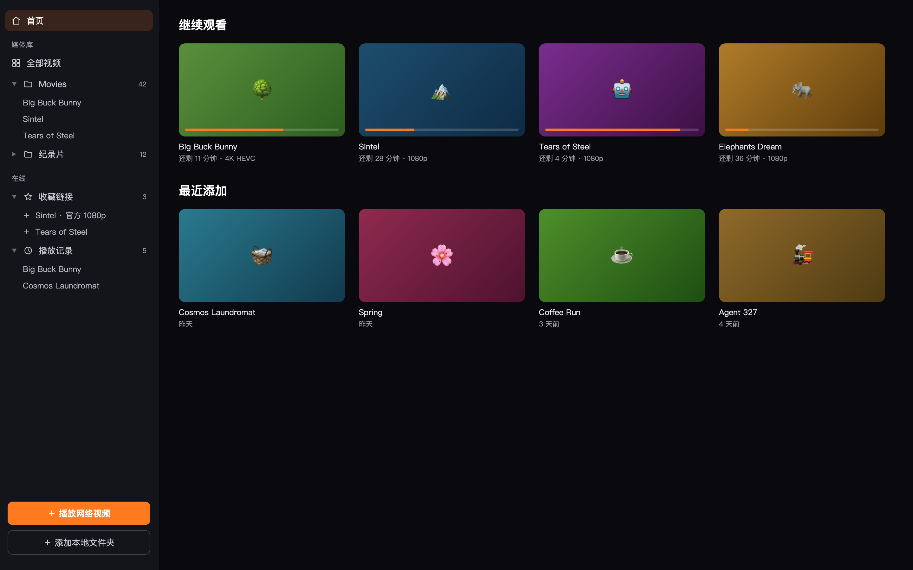
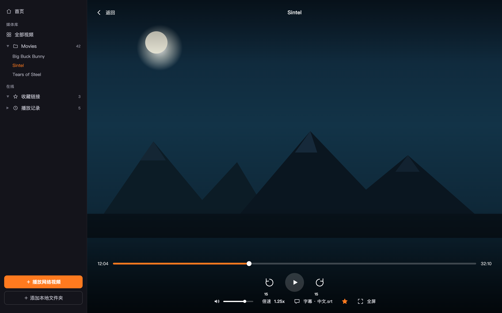
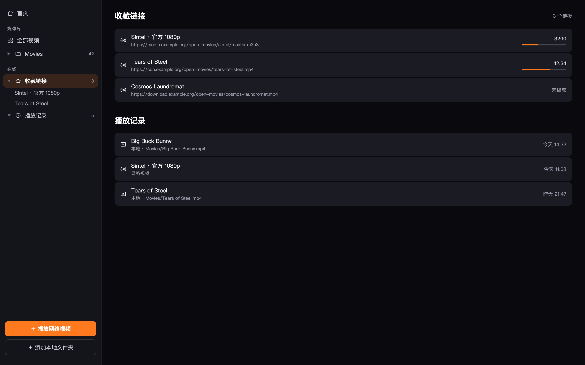

# FreedomPlayer

macOS 原生视频播放器（SwiftUI + AVPlayer），深色界面，纯 Swift Package，无需完整 Xcode（仅 Command Line Tools 即可构建）。

## 截图

| 首页 | 播放界面 |
| --- | --- |
|  |  |

| 收藏链接 / 播放记录 |
| --- |
|  |

## 功能

- 本地视频播放：添加文件夹自动扫描，支持 MP4/MOV/M4V/AVI/TS 等格式（受 AVFoundation 支持范围约束，MKV/WMV/FLV/WebM 容器不被收录）
- 文件夹树形浏览，海报墙展示，自动生成缩略图，全部视频列表支持搜索
- 继续观看：自动记忆播放进度（退出前强制写盘），下次接着看
- 网络视频：支持 http/https 的 MP4 直链、HLS（m3u8），收藏链接与播放记录分开保存（记录自动封顶 200 条）
- 字幕：自动加载同名 SRT/VTT 字幕（UTF-8 / GB18030 编码自动识别），支持内嵌字幕轨道，可手动加载外挂字幕
- 音轨切换：多音轨视频可在播放界面选择音轨
- 播放反馈：快进/音量/倍速操作有居中 OSD 提示；播放失败（格式不支持、文件损坏、网络断开）有明确错误提示
- 音量、倍速设置跨启动记忆；变速播放保持音高不变
- 播放队列：从文件夹/列表进入播放时自动带上同目录视频，支持上一个/下一个与自动连播（可在设置中关闭）
- 画中画：支持 macOS 原生画中画（PiP）
- 进度条悬停预览：鼠标悬停显示目标时间
- 设置页（⌘,）：自动连播、记忆进度、字幕字号、清理缩略图缓存
- 快捷键：空格 播放/暂停，←/→ 快退/快进 10 秒，双击画面全屏，Esc 返回（全屏时先退全屏）

## 下载安装包

前往 [Releases](../../releases) 页面下载 **`FreedomPlayer-<版本号>-macOS-arm64.dmg`**：

1. 双击打开 DMG
2. 把 FreedomPlayer 图标**拖进旁边的「Applications」文件夹**
3. 完成，去启动台打开

首次打开如提示「无法验证开发者」（本地自签名分发，未经 Apple 公证）：系统设置 → 隐私与安全性 → 底部「仍要打开」；或在终端执行 `xattr -cr /Applications/FreedomPlayer.app`。

> `.zip` 包内容相同（app + 安装说明），供喜欢手动解压的用户使用。

发布流程：推送 `v*` 标签（如 `v1.0.0`）后，GitHub Actions 自动跑测试、构建并上传 DMG / zip 到 Releases；本地构建产物在 `build/dist/`。

## 构建与启动

```bash
./build_app.sh
```

一键完成：release 编译 → 代码绘制图标并生成 icns → 组装 `build/FreedomPlayer.app` → 本地自签名 → 打包 zip → 安装到 `/Applications/FreedomPlayer.app` 并自动启动。

也可以只编译运行：

```bash
swift build -c release
.build/release/FreedomPlayer
```

运行单元测试需要完整 Xcode（Command Line Tools 不含测试运行时）：

```bash
swift test
```

构建出的 zip 分发包在 `build/dist/FreedomPlayer.zip`。本应用为本地自签名分发，首次打开如提示「无法验证开发者」，在终端执行：

```bash
xattr -cr /Applications/FreedomPlayer.app
```

## 使用说明

### 本地播放

1. 点侧边栏下方「**添加本地文件夹**」（或按 ⇧⌘O），选择存放视频的文件夹（可多选），app 会自动递归扫描
2. 侧边栏「媒体库」下会生成文件夹树，可展开逐层浏览；「全部视频」查看所有影片并支持搜索
3. 点海报或树节点开始播放，海报下方橙色进度条表示观看进度

### 网络播放与收藏

1. 点侧边栏下方「**播放网络视频**」（可顺手起个名字），粘贴 MP4 直链或 m3u8 地址，点「播放」
2. 播放过的网络视频会出现在「**播放记录**」，随时可以接着看
3. 想长期保存的链接，播放时点控制条上的 **☆ 星标**，就会进入「**收藏链接**」
4. 收藏和记录都是侧边栏可展开的树，播放中点击任意条目即可切换视频；右键可删除或清空

### 字幕

- 自动加载与视频同名的 `.srt` / `.vtt` 字幕（自动识别 UTF-8 / GB18030 编码）
- 内嵌字幕轨道可通过控制条「字幕」菜单切换
- 多音轨视频通过控制条「音轨」菜单切换

## 快捷键

| 按键 | 功能 |
| --- | --- |
| 空格 | 播放 / 暂停 |
| ← / → | 快退 / 快进 10 秒 |
| 双击画面 | 进入 / 退出全屏 |
| Esc | 全屏时先退全屏，否则返回列表 |
| ⌘O | 打开视频文件 |
| ⇧⌘O | 打开文件夹 |

## 要求

- Apple Silicon（M 系芯片）Mac
- macOS 13.0 或更高版本

## 目录结构

```
FreedomPlayer/
├── build_app.sh                       # 一键构建打包脚本
├── make_icon.swift                    # 图标代码绘制（构建时生成 icns）
├── Sources/FreedomPlayer/
│   ├── FreedomPlayerApp.swift         # 入口（菜单命令、文件关联打开）
│   ├── RootView.swift                 # 主界面（侧边栏、首页、列表、弹窗）
│   ├── LibraryStore.swift             # 媒体库数据与持久化
│   ├── PlayerController.swift         # AVPlayer 播放控制
│   ├── PlayerView.swift               # 播放界面与控制条
│   ├── SubtitleParser.swift           # SRT/VTT 字幕解析
│   ├── Theme.swift                    # 深色主题
│   └── ThumbnailLoader.swift          # 海报缩略图缓存
└── Tests/FreedomPlayerTests/          # 单元测试（Swift Testing）
```

## 打赏

如果 FreedomPlayer 对你有帮助，欢迎请作者喝杯咖啡 ☕


## 许可

[MIT](LICENSE)。示例截图中出现的影片名来自 [Blender 开放电影项目](https://studio.blender.org/films/)（CC 授权），画面为演示用合成图。
